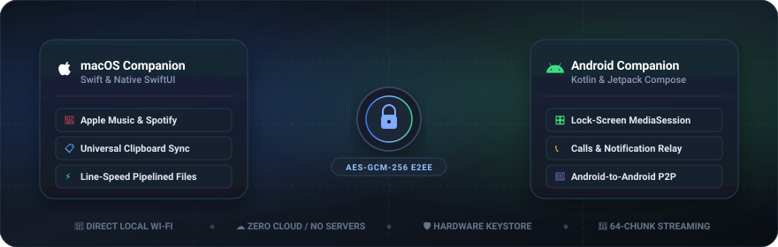
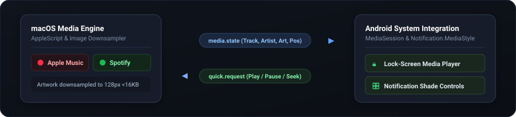

<div align="center">

# SYNQ

### The missing Continuity bridge between macOS & Android.

**Local Wi-Fi &bull; Zero Cloud &bull; Hardware-Backed Encryption &bull; Line-Speed Transfers**

<p align="center">
  <a href="https://github.com/bharadwajsanket/SYNQ/releases/latest/download/SYNQ-macOS.dmg"></a>
  &nbsp;
  <a href="https://github.com/bharadwajsanket/SYNQ/releases/latest/download/SYNQ-Android.apk"></a>
  &nbsp;
  <a href="https://github.com/bharadwajsanket/SYNQ/releases/latest"></a>
</p>

<p align="center">
  
</p>

</div>

---

Apple’s ecosystem features are great, but only if you use an iPhone. If you carry an Android phone with a Mac, you’re stuck emailing links to yourself or bouncing files through cloud drives.

**SYNQ fixes that.** It links your Mac and Android phone directly over your local network — no accounts, no cloud relays, no tracking. Pair once and it just works.

---

## What It Does

* **🎵 Remote Media Control:** Control **Apple Music** and **Spotify** playing on your Mac right from your phone. Real-time track info, album artwork, timeline scrubbing, volume, and full Android lock-screen controls via `MediaSession`.
* **📋 Universal Clipboard:** Copy text or links on your Mac, paste on your phone, and vice-versa. Smart links open directly in your browser. Password managers stay protected.
* **⚡ Blazing File Transfers:** Send gigabyte files at full Wi-Fi line speed using 64-chunk pipelining and SHA-256 integrity verification.
* **📁 Remote File Browser:** Browse your phone’s storage from the Mac menu bar and pull photos, documents, or downloads straight into Finder.
* **📞 In-Panel Calls &amp; SMS:** Dial contacts and send SMS messages directly from your Mac menu bar without touching your phone.
* **👤 Guest Share:** Let anyone (iPhone, Android, Windows) send files to your Mac by scanning a QR code with their camera. No app needed on their end.
* **🤝 Android-to-Android:** Direct encrypted file transfers between two Android devices on the same Wi-Fi.
* **🔔 Notification Mirroring:** View and dismiss phone notifications on your Mac, with automatic OTP extraction and quick replies.

---

## Media Remote Pipeline

<p align="center">
  
</p>

* **Dual-Source Auto-Detect:** Detects whether Apple Music or Spotify is playing audio and auto-switches controls.
* **Lock-Screen Controls:** Live scrub bar, album art, and transport buttons inside Android’s native media player. Cleanly dismisses when paused.
* **Mac Privacy Toggle:** Turn off media sharing anytime under **Settings → Media**.

---

## Security &amp; Privacy

* **100% Local:** All traffic stays on your local Wi-Fi. Zero packets leave your network.
* **End-to-End Encrypted:** Every payload is sealed with **AES-GCM-256** using unique initialization vectors and replay protection.
* **Mutual SAS Pairing:** Ephemeral P-256 ECDH key exchange with a 6-digit confirmation code on both screens to prevent MITM attacks.
* **Hardware Storage:** Identity keys are locked inside the **macOS Keychain** and **Android KeyStore**.

---

## Quick Start

### 1. Install
* **Mac:** Download [`SYNQ-macOS.dmg`](https://github.com/bharadwajsanket/SYNQ/releases/latest/download/SYNQ-macOS.dmg) and drag **SYNQ** to your `Applications` folder.
* **Android:** Download [`SYNQ-Android.apk`](https://github.com/bharadwajsanket/SYNQ/releases/latest/download/SYNQ-Android.apk) and install on your phone.

### 2. Pair
1. Connect both devices to the same Wi-Fi network.
2. Open **SYNQ** on your Mac and phone.
3. Scan the Mac's QR code with the Android app and confirm the 6-digit code.
4. **Done.** Devices reconnect automatically whenever you're nearby.

---

## Build from Source

```bash
# macOS (Swift & SwiftUI)
cd macos
./run-tests.sh          # Run 131 tests
./package-release.sh    # Builds DMG & ZIP in macos/dist/

# Android (Kotlin & Jetpack Compose)
cd android
./gradlew testDebugUnitTest    # Run 97 tests
./gradlew assembleRelease      # Output: app/build/outputs/apk/release/
```

---

## Deep Dive &amp; Documentation

For protocol wire formats, architecture diagrams, and testing specs:
* [Architecture Overview](docs/architecture.md)
* [Protocol &amp; Wire Format](docs/protocol.md)
* [Remote Media Specification](docs/media.md)
* [Security &amp; Threat Model](SECURITY.md)
* [Changelog](CHANGELOG.md) · [Release Notes](RELEASE_NOTES_4.5.4.md)

---

## License

Open source under the [MIT License](LICENSE).

Crafted by **[Sanket Bharadwaj](https://github.com/bharadwajsanket)**.
