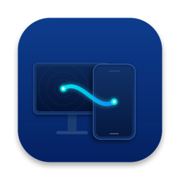

<p align="center">
  
</p>

<h1 align="center">SYNQ</h1>

<p align="center">
  <strong>Your Mac and Android phone, working together.</strong><br>
  A local-first companion for the small things that should just work across your devices.
</p>

<p align="center">
  <a href="https://github.com/bharadwajsanket/SYNQ/releases/latest/download/SYNQ-macOS.dmg"></a>
  <a href="https://github.com/bharadwajsanket/SYNQ/releases/latest/download/SYNQ-Android.apk"></a>
  <a href="https://github.com/bharadwajsanket/SYNQ/releases/latest"></a>
</p>

<p align="center">
  <a href="https://github.com/bharadwajsanket/SYNQ/releases/latest">Latest release</a>
  &nbsp;·&nbsp; <a href="LICENSE">MIT license</a>
  &nbsp;·&nbsp; <a href="SECURITY.md">Security</a>
</p>

---

## One connection. Less friction.

SYNQ links a Mac and an Android phone directly over your local network. Copy text on one device and paste it on the other, move files, see phone notifications on your Mac, or start a phone call from the menu bar.

Pair your devices once. SYNQ reconnects when they’re back on the same network. Your data stays between your devices: SYNQ has no account, cloud relay, or third-party analytics.

## What you can do

|  |  |
|---|---|
| **Clipboard & Smart Links**<br>Send copied text and detected links seamlessly between Mac and Android. | **Files & Transfers**<br>AirDrop-style transfers with live previews, folder support, and direct drag-and-drop. |
| **Phone notifications**<br>See Android notifications in macOS Notification Center and use supported quick replies. | **Calls & SMS from Mac**<br>Place calls and compose SMS text messages directly to contacts from the menu bar. |
| **Contacts & Favourites**<br>Browse synced phone contacts and keep favourite numbers close at hand. | **Remote File Browser**<br>Explore Android files and download documents on demand from your Mac. |
| **Guest Share**<br>Let a nearby guest send files to your Mac through a temporary QR link, without pairing. | **Find your phone**<br>Ring it or send a quiet ping from your Mac with clear status feedback. |

## Get SYNQ

| App | Requirements | Install |
|---|---|---|
| **SYNQ for macOS** | macOS 13 Ventura or later | Download the [DMG](https://github.com/bharadwajsanket/SYNQ/releases/latest/download/SYNQ-macOS.dmg) (or [ZIP](https://github.com/bharadwajsanket/SYNQ/releases/latest/download/SYNQ-macOS.zip)), open it, then drag SYNQ to Applications. |
| **SYNQ for Android** | Android 8.0 (API 26) or later | Download the [APK](https://github.com/bharadwajsanket/SYNQ/releases/latest/download/SYNQ-Android.apk) and follow Android’s install prompt. |

Want the ZIP, checksums, or older versions? Visit [all releases](https://github.com/bharadwajsanket/SYNQ/releases/latest). macOS and Android checksums are published with each release when available.

### First connection

1. Install SYNQ on your Mac and Android phone.
2. Put both devices on the same Wi-Fi network.
3. Open SYNQ on both devices. The Mac discovers the phone nearby.
4. Choose the phone and compare the pairing code on both screens.
5. Accept the pairing. SYNQ creates an encrypted connection and reconnects on that network later.

## Privacy and permissions

SYNQ is designed to work device-to-device on your local network. Pairing uses a confirmation code and an encrypted session. SYNQ does not require an account or send your content to a SYNQ-operated cloud service.

Some features need extra access on Android. SYNQ asks when you enable the related feature:

| Access | Used for |
|---|---|
| Contacts | Syncing the phone directory and choosing call favourites. |
| Notification access | Mirroring notifications and relaying supported notification actions. |
| Phone state and call controls | Optional call status, answer, decline, and hang-up integration. |
| Send SMS | Sending SMS text messages composed from your Mac menu bar. |
| Notifications | Showing SYNQ’s pairing, transfer, and call confirmation alerts. |

SYNQ does not read your SMS database or call log and does not replace your default phone or messaging app. See the [telephony and permissions policy](docs/sms-call-policy.md), [security notes](docs/security-testing.md), and [security reporting guide](SECURITY.md).

## Good to know

- Both devices need to be on the same reachable local network. SYNQ does not provide internet relay or remote access.
- Phone calls are placed by Android after you confirm on the phone. Mac microphone and speaker calling is not currently supported.
- Notification replies depend on whether the source app exposes a reply action.
- Android may restrict background activity to save battery. If SYNQ stops reconnecting while your phone is idle, allow background use for SYNQ in Android settings.
- Builds without Developer ID signing and notarization may require you to approve the app in macOS Privacy & Security before opening it.

## Build from source

### macOS

**Requirements:** macOS 13+ and Xcode 15 or newer.

```bash
cd macos
./build-app.sh
```

The app bundle is created at `macos/.build/debug/SYNQ.app`. To package a DMG and ZIP for distribution:

```bash
cd macos
./package-release.sh
```

### Android

**Requirements:** JDK 17 and Android SDK (API 26+).

```bash
cd android
./gradlew assembleDebug
```

The APK is created at `android/app/build/outputs/apk/debug/app-debug.apk`. Release builds use a signing key; see the [release guide](docs/releasing.md).

### Run the test suites

```bash
cd macos && swift test
cd ../android && ./gradlew testDebugUnitTest
```

## How it works

SYNQ discovers paired devices with Bonjour/mDNS and communicates directly over the local network. The protocol uses P-256 ephemeral key agreement, HKDF key derivation, and AES-GCM authenticated encryption. File transfers are chunked and checked for integrity. Read the [architecture overview](docs/architecture.md) and [wire protocol](docs/protocol.md) for implementation details.

## Project

SYNQ is an independent open-source project created and maintained by **Sanket Bharadwaj**.

- [Browse the source](https://github.com/bharadwajsanket/SYNQ)
- [Report a bug or request a feature](https://github.com/bharadwajsanket/SYNQ/issues)
- [Read the release notes](RELEASE_NOTES.md)
- [Read the license](LICENSE)

Contributions and clear bug reports are welcome. Please review the [security policy](SECURITY.md) before reporting a vulnerability.
